# Claude Code & Antigravity Anime Themes

**English** | [Tiếng Việt](README.vi.md)

Anime live wallpaper (video background) themes for **Google Antigravity**, and animated pixel-art themes for the **Claude Code desktop app** (Claude desktop, Code tab). Install scripts for Linux and macOS, and an [AGENTS.md](AGENTS.md) for AI coding agents.

- **Antigravity**: a looping video behind the whole editor, frosted-glass panels, 9 presets (5 new) switched from the **Custom theme** button in the sidebar. Built on [furinamikuvn/antigravity-custom-theme-mod](https://github.com/furinamikuvn/antigravity-custom-theme-mod) (MIT).
- **Claude Code desktop**: 4 pixel-art themes animated only with pixel effects: blinking stars, sparkles, a Bayer-dithered moon halo, a falling star and fireflies. A modified copy of Anthropic's `theme-examples` plugin (Apache-2.0).

Tested on Ubuntu with Claude Code 2.1.330.

## Demo

> The GIFs below are **simulations** built by [docs/make_demos.py](docs/make_demos.py), not screen recordings. The Claude ones replay the theme's shader in Python on the real 160×90 still. The sidebar and message box are a mock of the frosted-glass UI. Short, small previews only: the artwork belongs to its authors (see [Credits](#credits)).

### Claude Code desktop (pixel art)

| Moonlit Whale (`whale-moon-pixel`) | Snow & Moon (`snow-moon-pixel`) |
|---|---|
| 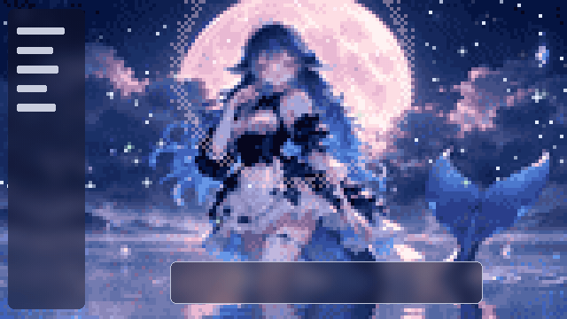 | 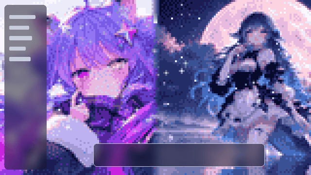 |
| **Sea Dream** (`sea-dream-pixel`) | **Blade Duet** (`blade-duet-pixel`) |
| 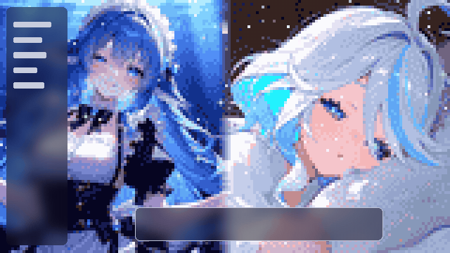 | 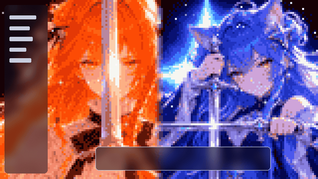 |

### Antigravity (video background)

| DeepSeek Moonlit Whale Live | DeepSeek Underwater Maid Live |
|---|---|
| 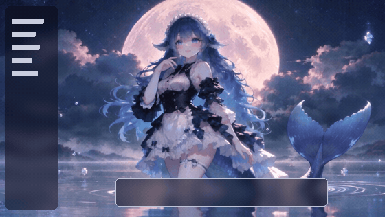 | 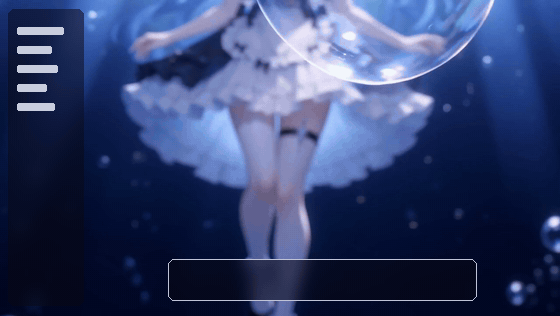 |
| **DeepSeek Whale Fantasy Live** | **Claude Moonlit Blade Live** |
| 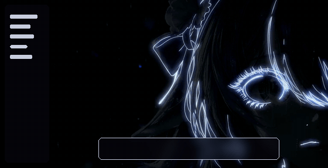 | 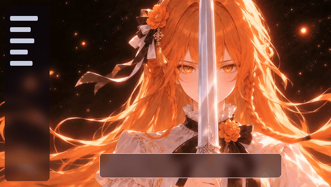 |
| **Gemini Twin Blades Live** | **Gemini-chan Live** |
| 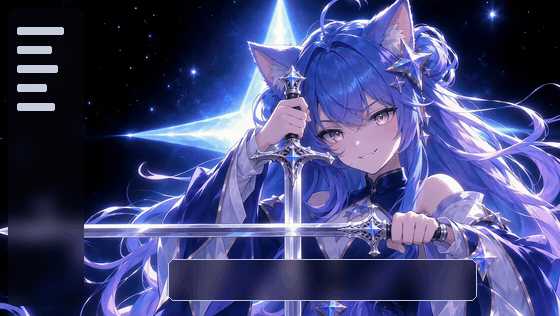 | 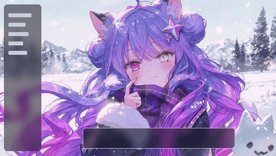 |
| **Furina Live** | |
| 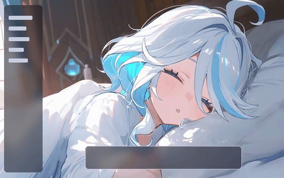 | |

## Install

Needs `git`, `curl`, `ffmpeg`, `python3` with Pillow (libimagequant), and Node.js 22+ for Antigravity.

```bash
git clone https://github.com/discourdhieuanh-art/claude-code-antigravity-anime-themes.git
cd claude-code-antigravity-anime-themes
./antigravity/install.sh        # clone the upstream mod, apply the patch, add presets, download the videos
bash ~/.local/share/antigravity-theme-mod/scripts/install-unix.sh   # the upstream background daemon
./claude/install.sh             # grab frames, build the pixel stills, install the plugin into Claude
```

If `claude` is not on your PATH: `CLAUDE=/path/to/claude ./claude/install.sh` (in the desktop app it is under `~/.config/Claude/claude-code/<version>/<hash>/claude`).

Only want the Claude themes? Run `./antigravity/fetch-videos.sh <folder>` to get the videos, then `./claude/install.sh <folder>`. Gemini-chan and Furina come from the upstream mod's `themes/assets`.

### Use

- **Antigravity**: start it with `antigravity --remote-debugging-port=0 --remote-debugging-address=127.0.0.1`, then click **Custom theme** in the sidebar to pick a preset.
- **Claude**: open a new session, send a message, then type `/custom-theme whale-moon-pixel` (or `snow-moon-pixel`, `sea-dream-pixel`, `blade-duet-pixel`). `/custom-theme list` lists them all. Projects with no theme of their own get Moonlit Whale. To change that default, edit `DEFAULT_THEME` in `claude/plugin/theme-examples-default/hooks/register.tsx`.

## What changed from the upstream Antigravity mod

[antigravity/antigravity-mod.patch](antigravity/antigravity-mod.patch):

- The daemon only accepts requests from `127.0.0.1` / `localhost`. File read/write APIs called from any other web page get 403.
- Fixes the Custom theme button not showing in the sidebar of newer Antigravity builds.
- [antigravity/themes.json](antigravity/themes.json) adds 5 video presets.

## Why the Claude themes are not as sharp as Antigravity

These are limits of the Claude Code theme API, not of the conversion:

1. **No embedded images.** Antigravity lets the mod inject CSS and a `<video>` tag. A Claude theme backdrop is a **vector SVG** only, with `data:` URLs forbidden, so no PNG, JPG or video can go in.
2. **The SVG is capped at 131,072 characters.** Each run of same-colour pixels is one path segment. A 160×90 image in 32 colours already takes 116k–127k characters. 320×180 would need about 4 times that.
3. **The shader cannot load textures.** It only reads back the backdrop (that same 160×90 picture) and adds effects on top. It cannot add detail.
4. **Upscaling.** On a 1920×1080 window each art pixel becomes a 12×12 block. A face is only a few pixels wide, worse in the duo themes, where each character gets 80×90.

[claude/make_stills.py](claude/make_stills.py) keeps as much detail as fits: denoise, contrast and colour boost, unsharp mask, Lanczos downscale, then a libimagequant palette. For better results, start from real pixel art drawn at 160×90 instead of video frames.

## Repository layout

```
antigravity/   patch, presets (themes.json), fetch-videos.sh, install.sh
claude/        plugin/theme-examples-default (the Claude plugin), make_stills.py, grab-frames.sh, install.sh
docs/          make_demos.py and the demo GIFs
AGENTS.md      guide for AI coding agents (also CLAUDE.md)
```

## Credits

| Video | Source |
|---|---|
| Gemini-chan, Furina (and WLOP Cosmic, Midnight Obsidian presets) | [furinamikuvn/antigravity-custom-theme-mod](https://github.com/furinamikuvn/antigravity-custom-theme-mod) |
| DeepSeek Whale Fantasy | [1745761934/dsh-skin-whale-fantasy](https://github.com/1745761934/dsh-skin-whale-fantasy) |
| DeepSeek Moonlit Whale, Underwater Maid | [kingOfSoySauce/dsh-boot-animation](https://github.com/kingOfSoySauce/dsh-boot-animation) |
| Claude Moonlit Blade, Gemini Twin Blades | [wynneceles/ai-boot-animations](https://github.com/wynneceles/ai-boot-animations) |

| Claude theme | Pixel art made from |
|---|---|
| Moonlit Whale | DeepSeek Moonlit Whale |
| Snow & Moon | Gemini-chan + DeepSeek Moonlit Whale |
| Sea Dream | DeepSeek Underwater Maid + Furina |
| Blade Duet | Claude Moonlit Blade + Gemini Twin Blades |

## License

- This repository's code: MIT ([LICENSE](LICENSE)).
- `claude/plugin/theme-examples-default`: modified from Anthropic `theme-examples`, Apache-2.0. See its `LICENSE` and `CHANGES.md`.
- `antigravity/antigravity-mod.patch`: a patch to furinamikuvn's MIT mod ([antigravity/LICENSE-upstream-MIT](antigravity/LICENSE-upstream-MIT)).
- Videos, artwork and characters belong to their authors and owners. They are not distributed here. The scripts download them from the original repositories. The GIFs in `docs/demo` are short, low-resolution previews only.
