# Theme anime cho Claude Code và Antigravity

[English](README.md) | **Tiếng Việt**

Theme nền video anime động cho **Google Antigravity**, và theme pixel art có hiệu ứng động cho **Claude Code desktop** (ứng dụng Claude, tab Code). Có script cài đặt cho Linux và macOS, cùng file [AGENTS.md](AGENTS.md) cho các AI agent.

- **Antigravity**: video chạy lặp phía sau toàn bộ giao diện, các khung kính mờ, 9 preset (5 preset mới), đổi bằng nút **Custom theme** ở thanh bên. Dựa trên [furinamikuvn/antigravity-custom-theme-mod](https://github.com/furinamikuvn/antigravity-custom-theme-mod) (MIT).
- **Claude Code desktop**: 4 theme pixel art, chỉ dùng hiệu ứng pixel: sao nhấp nháy, lấp lánh, quầng trăng dither Bayer, sao băng và đom đóm. Là bản sửa từ plugin `theme-examples` của Anthropic (Apache-2.0).

Đã thử trên Ubuntu với Claude Code 2.1.330.

## Demo

> Các GIF dưới đây là **mô phỏng** do [docs/make_demos.py](docs/make_demos.py) tạo ra, không phải quay màn hình. GIF của Claude chạy lại shader của theme bằng Python trên đúng ảnh 160×90 thật. Thanh bên và ô nhập tin nhắn là giao diện kính mờ giả lập. Đây chỉ là bản xem trước ngắn, độ phân giải thấp; hình vẽ thuộc về tác giả (xem [Nguồn](#nguồn)).

### Claude Code desktop (pixel art)

| Moonlit Whale (`whale-moon-pixel`) | Snow & Moon (`snow-moon-pixel`) |
|---|---|
| 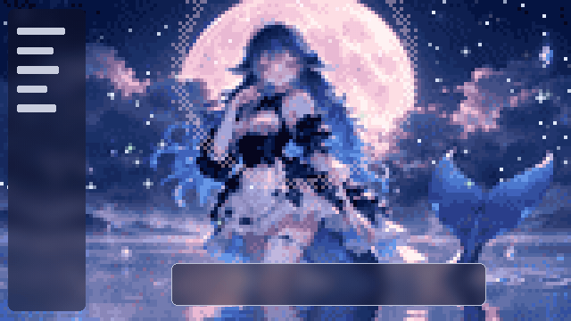 | 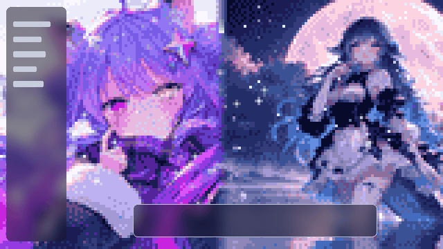 |
| **Sea Dream** (`sea-dream-pixel`) | **Blade Duet** (`blade-duet-pixel`) |
| 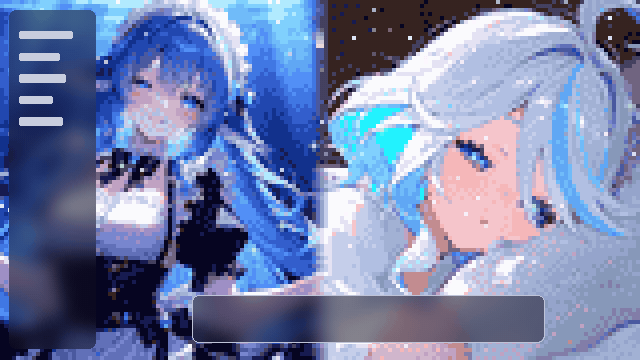 | 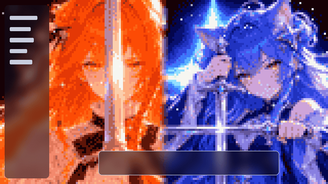 |

### Antigravity (nền video)

| DeepSeek Moonlit Whale Live | DeepSeek Underwater Maid Live |
|---|---|
| 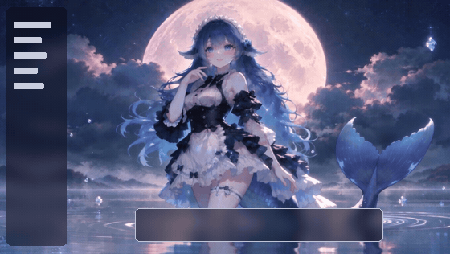 | 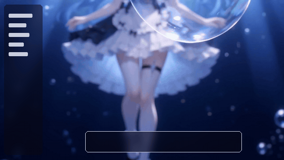 |
| **DeepSeek Whale Fantasy Live** | **Claude Moonlit Blade Live** |
| 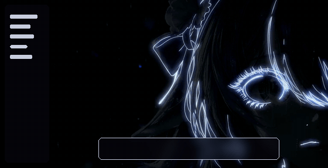 | 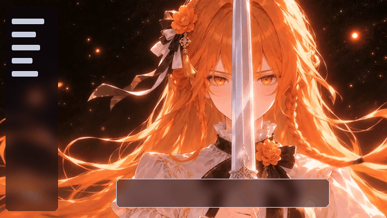 |
| **Gemini Twin Blades Live** | **Gemini-chan Live** |
| 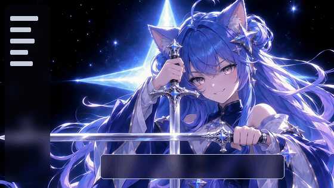 | 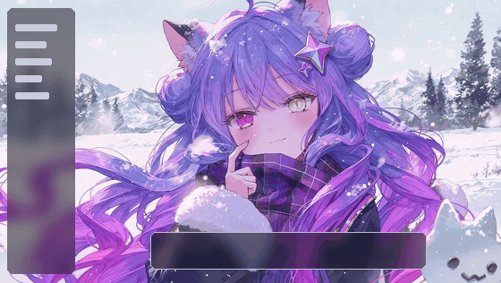 |
| **Furina Live** | |
| 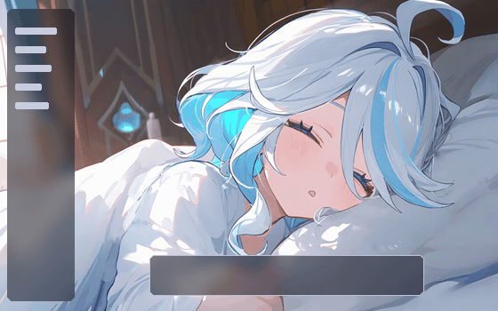 | |

## Cài đặt

Cần: `git`, `curl`, `ffmpeg`, `python3` có Pillow (libimagequant), và Node.js 22+ cho Antigravity.

```bash
git clone https://github.com/discourdhieuanh-art/claude-code-antigravity-anime-themes.git
cd claude-code-antigravity-anime-themes
./antigravity/install.sh        # clone mod gốc, áp bản vá, thêm preset, tải video
bash ~/.local/share/antigravity-theme-mod/scripts/install-unix.sh   # daemon nền của mod gốc
./claude/install.sh             # cắt khung hình, tạo ảnh pixel, cài plugin vào Claude
```

Nếu lệnh `claude` chưa có trong PATH: `CLAUDE=/đường/dẫn/claude ./claude/install.sh` (với ứng dụng desktop, nó nằm ở `~/.config/Claude/claude-code/<phiên bản>/<mã>/claude`).

Chỉ cần theme Claude? Chạy `./antigravity/fetch-videos.sh <thư mục>` để tải video, rồi `./claude/install.sh <thư mục>`. Hai video Gemini-chan và Furina lấy từ thư mục `themes/assets` của mod gốc.

### Sử dụng

- **Antigravity**: mở bằng `antigravity --remote-debugging-port=0 --remote-debugging-address=127.0.0.1`, rồi bấm **Custom theme** ở thanh bên để chọn preset.
- **Claude**: mở phiên mới, gửi một tin nhắn, rồi gõ `/custom-theme whale-moon-pixel` (hoặc `snow-moon-pixel`, `sea-dream-pixel`, `blade-duet-pixel`). `/custom-theme list` liệt kê tất cả. Thư mục chưa chọn theme riêng sẽ tự dùng Moonlit Whale. Muốn đổi theme mặc định, sửa `DEFAULT_THEME` trong `claude/plugin/theme-examples-default/hooks/register.tsx`.

## Thay đổi so với mod Antigravity gốc

[antigravity/antigravity-mod.patch](antigravity/antigravity-mod.patch):

- Daemon chỉ nhận yêu cầu từ `127.0.0.1` / `localhost`. Trang web khác gọi API đọc/ghi file sẽ bị từ chối (403).
- Sửa lỗi nút Custom theme không hiện ở thanh bên của các bản Antigravity mới.
- [antigravity/themes.json](antigravity/themes.json) thêm 5 preset video.

## Vì sao theme Claude không sắc nét bằng Antigravity

Đây là giới hạn của API theme trong Claude Code, không phải do cách chuyển ảnh:

1. **Không nhúng được ảnh.** Antigravity cho mod chèn CSS và thẻ `<video>`. Nền theme Claude chỉ nhận **SVG dạng vector**, cấm `data:` URL, nên không đưa PNG, JPG hay video vào được.
2. **SVG tối đa 131.072 ký tự.** Mỗi dải điểm ảnh cùng màu là một đoạn path. Ảnh 160×90 với 32 màu đã chiếm 116 nghìn đến 127 nghìn ký tự. Lên 320×180 sẽ cần khoảng gấp 4 lần.
3. **Shader không đọc được ảnh ngoài.** Nó chỉ đọc lại chính ảnh nền 160×90 và thêm hiệu ứng lên trên, không tạo thêm chi tiết.
4. **Ảnh bị phóng to.** Trên cửa sổ 1920×1080, mỗi điểm ảnh thành một ô 12×12. Gương mặt chỉ rộng vài điểm ảnh, càng tệ hơn ở theme ghép đôi, vì mỗi nhân vật chỉ có 80×90.

[claude/make_stills.py](claude/make_stills.py) đã giữ chi tiết tối đa trong giới hạn: lọc nhiễu, tăng tương phản và màu, làm nét, thu nhỏ Lanczos, rồi giảm màu bằng libimagequant. Muốn đẹp hơn, nên dùng ảnh pixel art vẽ sẵn ở 160×90 thay vì cắt từ video.

## Cấu trúc thư mục

```
antigravity/   bản vá, preset (themes.json), fetch-videos.sh, install.sh
claude/        plugin/theme-examples-default (plugin cho Claude), make_stills.py, grab-frames.sh, install.sh
docs/          make_demos.py và các GIF demo
AGENTS.md      hướng dẫn cho AI agent (bản sao: CLAUDE.md)
```

## Nguồn

| Video | Nguồn |
|---|---|
| Gemini-chan, Furina (cùng preset WLOP Cosmic, Midnight Obsidian) | [furinamikuvn/antigravity-custom-theme-mod](https://github.com/furinamikuvn/antigravity-custom-theme-mod) |
| DeepSeek Whale Fantasy | [1745761934/dsh-skin-whale-fantasy](https://github.com/1745761934/dsh-skin-whale-fantasy) |
| DeepSeek Moonlit Whale, Underwater Maid | [kingOfSoySauce/dsh-boot-animation](https://github.com/kingOfSoySauce/dsh-boot-animation) |
| Claude Moonlit Blade, Gemini Twin Blades | [wynneceles/ai-boot-animations](https://github.com/wynneceles/ai-boot-animations) |

| Theme Claude | Ảnh pixel làm từ |
|---|---|
| Moonlit Whale | DeepSeek Moonlit Whale |
| Snow & Moon | Gemini-chan + DeepSeek Moonlit Whale |
| Sea Dream | DeepSeek Underwater Maid + Furina |
| Blade Duet | Claude Moonlit Blade + Gemini Twin Blades |

## Giấy phép

- Code của repo này: MIT ([LICENSE](LICENSE)).
- `claude/plugin/theme-examples-default`: bản sửa từ `theme-examples` của Anthropic, Apache-2.0. Xem `LICENSE` và `CHANGES.md` trong thư mục đó.
- `antigravity/antigravity-mod.patch`: bản vá cho mod MIT của furinamikuvn ([antigravity/LICENSE-upstream-MIT](antigravity/LICENSE-upstream-MIT)).
- Video, hình vẽ và nhân vật thuộc về tác giả và chủ sở hữu tương ứng, không phân phối kèm repo này; script tải chúng từ kho gốc. Các GIF trong `docs/demo` chỉ là bản xem trước ngắn, độ phân giải thấp.
